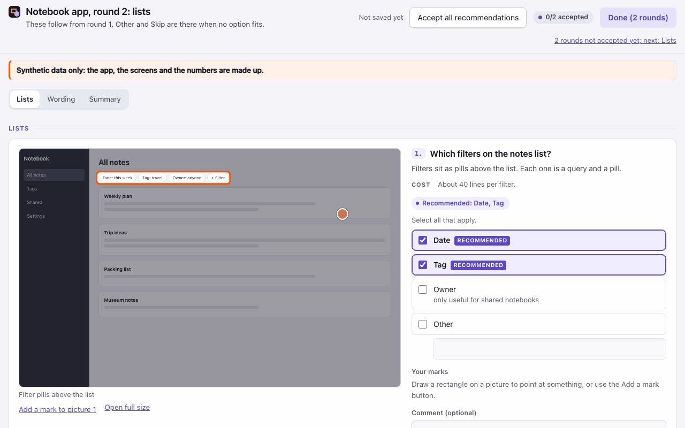
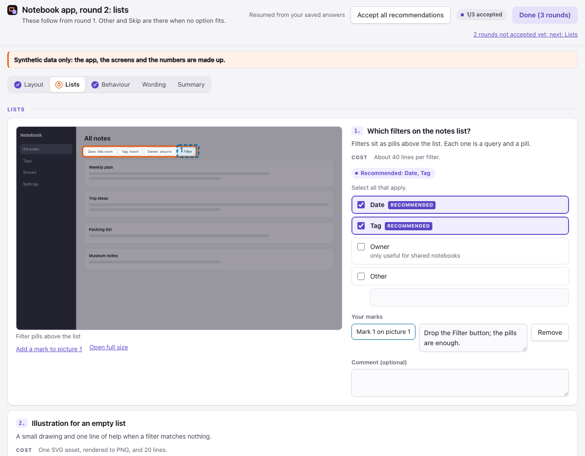
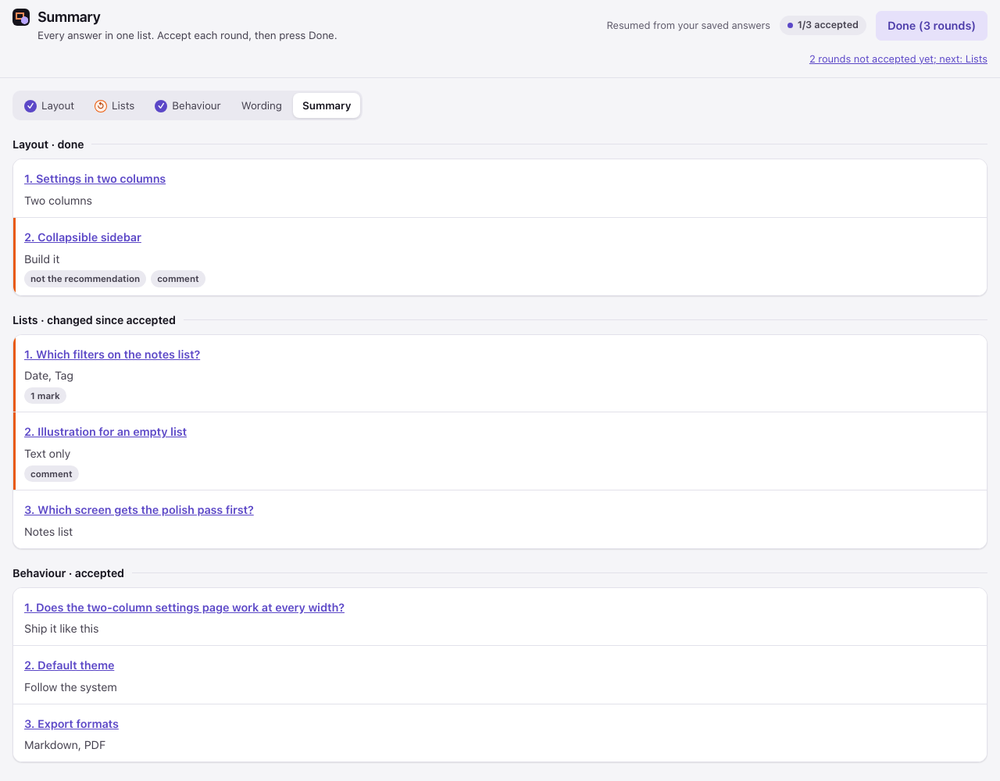
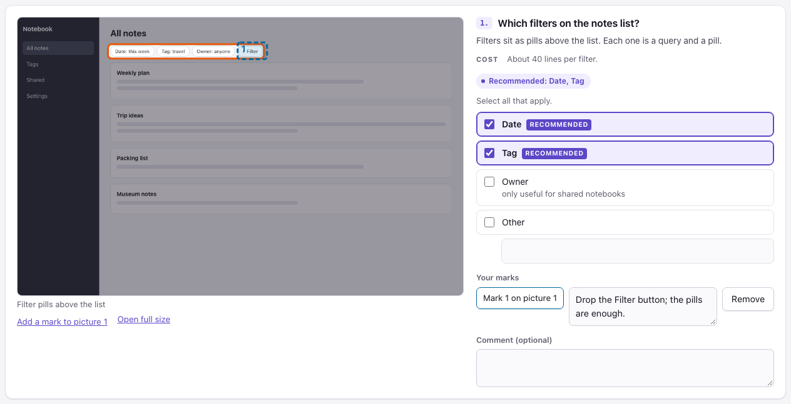
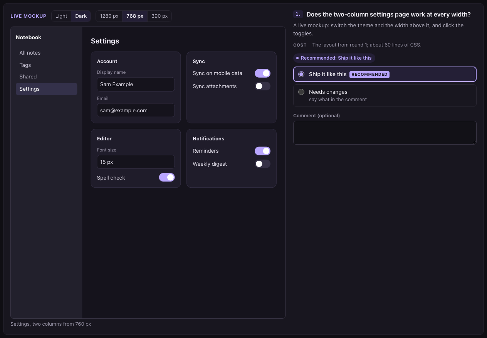
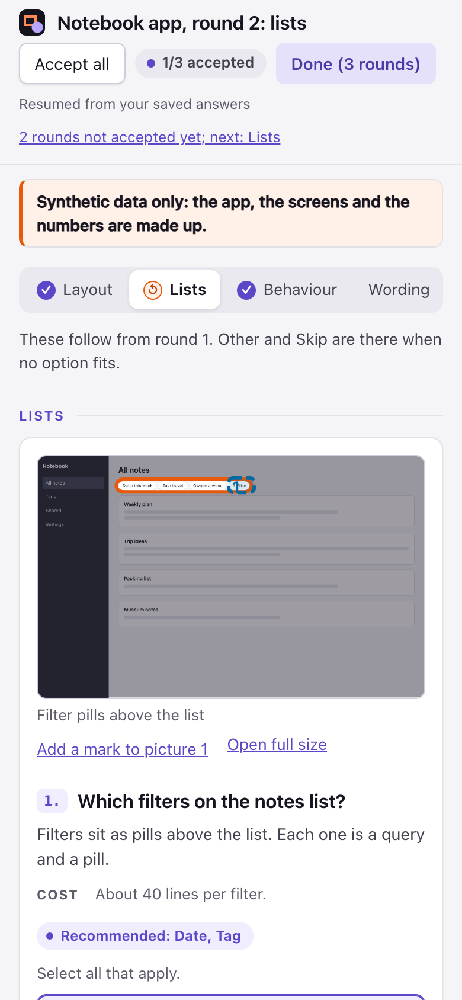
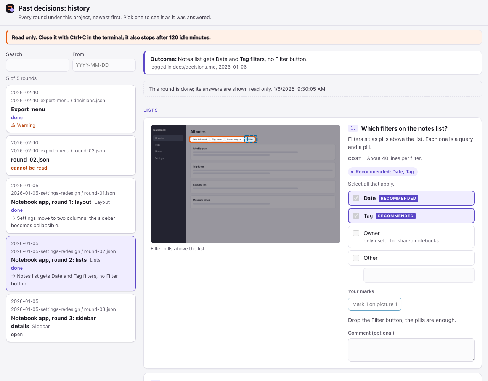

# Signoff

**Your coding agent puts its open decisions on one local page: mockups with the spot boxed in orange, the cost
of each option, its recommendation preselected. You answer, accept, press Done, and the agent carries on.**

[](https://github.com/trustmeimlumi/signoff/actions/workflows/test.yml)
[](LICENSE)



Signoff is a Claude Code plugin: a small Python server, one static page, and a skill that teaches the agent
when and how to use them. The agent writes a JSON file of decisions for each round of questions. Signoff serves
them on `127.0.0.1`, one tab per round, and opens your browser. Every click and comment is saved as you go. You
accept each round, check the Summary, and press **Done**: Signoff exits and prints the paths of the answers
files, and the agent, which ran it in the background, wakes up and reads them. Rounds you answered earlier stay
on the page as read-only tabs, so you can look back at what you said.

## Who it's for

You let an agent do a design pass, a cleanup or a migration plan, and it comes back with a dozen questions.
In the terminal that is a wall of text, or several rounds of four questions at a time, and some of them only
make sense next to a screenshot. Signoff puts them on one page, each with its picture, its cost and the agent's
recommendation, so you can go through them in a few minutes and leave a comment where a choice is not enough.

For one to three quick questions without pictures, Claude Code's own question prompt is still the better tool;
the skill tells the agent so.

## How it works


1. The agent writes `round-01.json` (and more rounds, if they do not depend on each other) into a folder for
   the topic, with the pictures beside it.
2. It starts `signoff.py` on that folder in the background. Signoff opens your browser with a link that works
   once.
3. You answer. Everything is saved to `round-NN.answers.json` as you go.
4. You accept each round and press **Done**. Signoff exits, printing one answers path per line; that exit is what
   wakes the agent.
5. The agent reads the answers, does the work, and records what came of each round.

In the clip above, a small script stands in for the person at the browser (`media/demo/answer.py`): the terminal
has none. It sends the same requests the page does.

## Requirements

- **Claude Code on your own computer.** Signoff starts a local server and opens your browser on the machine
  Claude Code runs on, so it works only in Claude Code there: not on claude.ai on the web or on mobile, and not
  in Cowork.
- **Claude Code**: CI validates the plugin with a pinned version, 2.1.309 at the time of writing.
- **Python 3.9 or newer** as `python3` (macOS, Linux) or through the `py` launcher (Windows). Standard library
  only; nothing to install.
- A web browser on the same machine. Over SSH, see `--no-open` under [Running it yourself](#running-it-yourself).

## Where it works

| | Status |
|---|---|
| Terminal (`claude`) on macOS | Tested. |
| Linux, Windows | The test suite runs in CI on both, with Python 3.9 and 3.13. A browser check runs there too: the server and the page in headless Chrome, with real mouse clicks, from the start link to Done (see [Development and tests](#development-and-tests)). Not tried in a real Claude Code session yet. |
| Desktop app, VS Code extension | Untested. |
| claude.ai (web, mobile) and Cowork | Not supported: the plugin does not install there. |
| Chrome | Tested, headless, driven over the DevTools protocol. |
| Firefox, Safari | Untested. |
| Other agents (Codex, Cursor, Cline) | Through the [MCP server](#other-agents-the-mcp-server); the config snippets are untested. |

## Install, update, uninstall

At the prompt of a terminal session:

```
/plugin install signoff --marketplace trustmeimlumi/signoff
```

From a shell:

```
claude plugin install signoff --marketplace trustmeimlumi/signoff
```

In the desktop app: + next to the prompt box → Plugins → Add marketplace `trustmeimlumi/signoff` → Add plugin.

Update: `claude plugin update signoff@signoff`, then `/reload-plugins`.
Uninstall: `claude plugin uninstall signoff@signoff`. Decision folders and answers files in your projects stay
where they are.

## Quick start

**Try the page** from a clone of this repository:

```
python3 -I plugin/signoff/signoff.py examples/demo
```

Four rounds of a synthetic settings redesign open as tabs. Your answers go to `examples/demo/*.answers.json`,
which git ignores. Run it again and the page resumes from them; a round you finished with Done stays read only,
and once every round is done Signoff says so and exits.

**With an agent** there is nothing to set up. When it has four or more decisions for you, or one that needs a
picture or a cost, the `signoff` skill tells it to:

1. make a topic folder, `.signoff/<YYYY-MM-DD>-<slug>/` in the project, or under the folder you set as the
   plugin's Decisions folder option in `/config`, relative to the project root or absolute;
2. write the round there, at most three open rounds and about twelve items each;
3. run `python3 -I "${CLAUDE_PLUGIN_ROOT}/signoff/signoff.py" "<folder>"` in the background, from the main
   session (a background command started by a subagent ends with it);
4. read every line of stdout when it exits, act on the answers, and record the outcome.

You can also ask for it directly: "put these on a Signoff page".

## On the page

<picture>
  <source media="(prefers-color-scheme: dark)" srcset="media/page-dark.png">
  
</picture>

- **Rounds are tabs.** A round answered with Done in an earlier run is read only and ticked. A round that
  depends on earlier answers comes as a new run on the same folder, so the earlier ones stay in view.
- **Pictures, boxes, costs.** Each item shows its pictures on the left, with the relevant part boxed in orange
  and the rest dimmed, and the question on the right: description, cost, options, comment. Click a picture to
  open it full size. When the options look different, the agent shows one picture per option, captioned with
  the option's name.
- **The recommendation is preselected** and labelled **Recommended**. Change what you disagree with. **Accept
  all recommendations** in the header resets the open tab to the recommendations, comments untouched; clicking
  it again undoes that, until you change an item's options.
- **Other and Skip** appear where the agent allows them: Other with its own text field, Skip on its own.
- **Everything saves as you go**; the header shows when it last saved. The box at the end of each tab takes
  anything the list did not ask.
- **Accept each round.** With more than one round open, **Accept this round** at the end of a tab (or Ctrl+Enter,
  Cmd+Enter on a Mac) ticks it and moves on to the next round not accepted yet. The header counts them, "2/3
  accepted". Change anything in an accepted round, a comment included, and its tab shows ↺ until you accept it
  again.
- **The Summary tab** lists every answer, flags where you departed from the recommendation, chose Other or Skip,
  drew marks or wrote a comment, and links back to each item.
- **Done waits.** Until every open round is accepted, Done says which one is missing and takes you there; the
  server refuses an early Done too (409). Then Done closes every round at once and tells the agent. With a single
  round there is nothing to accept: Done does both.
- **A notice** from the agent, such as "Synthetic data only", shows as a banner under the header.



### Marks

Where the agent asks for it (`"marks": true`), you can point at things: drag a rectangle over the part of a
picture you mean, in blue so it stands apart from the agent's orange boxes, and write a comment for it. Without a
mouse, **Add a mark** puts one in the middle of the picture; on the mark's button the arrow keys move it and
Shift with the arrow keys resizes it. **Remove** deletes it.



### Live mockups (boards)

Instead of a picture, an item can show a board: the agent's own HTML page, running sandboxed, with switches for
light or dark and for a 1280, 768 or 390 pixel wide view, scaled to fit. Toggles and menus in it work; it cannot
read the Signoff page or save anything.



### Keyboard

The page works with the keyboard alone: Tab moves between fields, the arrow keys pick within a set of radio
buttons, Space ticks a checkbox. On top of that:

| Key | Does |
|---|---|
| `1` to `9` | picks that option in the current item (Other and Skip count last) |
| `j`, `k` | moves to the next or previous item |
| Left, Right, Home, End | on the tab list: switches rounds |
| arrow keys, Shift+arrow keys | on a mark: moves it, resizes it |
| Ctrl+Enter (Cmd+Enter on a Mac) | accepts the open round; with a single round, Done |
| `?` | lists the shortcuts |

The shortcuts do nothing while you type in a text field or hold Ctrl, Alt or Cmd (Ctrl+Enter aside), so
typing, browser shortcuts and screen reader commands work as usual.

### Light, dark, phone, language

The page follows your system's light or dark setting, keeps WCAG AA contrast in both, and fits a phone screen.
Its own labels are in English, or in Hungarian when the decisions file's `lang` says `hu`; your content can be
in any language.



## Past decisions

```
python3 -I plugin/signoff/signoff.py --history <project root> [--folder <decisions folder>] [--since YYYY-MM-DD]
```

A read-only page of every round under the project, newest first: the rounds in `.signoff/*/`, or in the folder
`--folder` names, with date, title, tab and status (done, open, not answered, or a file that cannot be read).
Filter by text or from a date, and open a round to see it as it was answered, marks included. A round whose
decisions changed after it was answered carries a warning; a missing picture shows a placeholder; a broken file
is listed with its error. Pictures are read when you open a round, up to 200 MiB for the whole list; past that,
narrow it with `--since`.

When the agent has acted on a round, it writes what came of it beside the round, as `<round>.outcome.json`, and
the page shows that line with the round:

```json
{"log": "docs/decisions.md", "line": "Settings move to two columns.", "date": "2026-01-05"}
```

Nothing on this page can be changed and nothing is written: it has no save route and no Done. Close it with
Ctrl+C; it also stops after the idle timeout.



## The decisions file

JSON, one file per round. [`plugin/signoff/schema.json`](plugin/signoff/schema.json) is its JSON Schema;
[`examples/demo/`](examples/demo/) holds a complete single round (`decisions.json`) and four rounds
(`round-01.json` to `round-04.json`), with mockups and a board.

```json
{
  "version": 1,
  "title": "What goes into the settings redesign?",
  "tab": "Layout",
  "intro": "My recommendation is preselected on each item.",
  "notice": "Synthetic data only",
  "lang": "en",
  "items": [
    {
      "id": "settings-layout",
      "group": "Layout",
      "title": "Settings in two columns",
      "description": "The settings page is one long column today.",
      "cost": "About 60 lines of CSS.",
      "images": [
        {"src": "mockups/settings.png", "caption": "Proposed", "boxes": [[20, 10, 40, 50]]}
      ],
      "options": [
        {"id": "two", "label": "Two columns"},
        {"id": "one", "label": "Keep one column", "detail": "no work"}
      ],
      "recommended": "two",
      "other": true,
      "marks": true
    }
  ],
  "free_text": {"title": "Anything else", "placeholder": "Anything the list does not ask about"}
}
```

| Key | Where | Required | Meaning |
|---|---|---|---|
| `version` | top | yes | always `1` |
| `title`, `intro` | top | `title` | the page heading and the line under it |
| `tab` | top | no | a short label for the round's tab; default the title |
| `notice` | top | no | a short banner under the header |
| `lang` | top | no | language tag of your text, default `en`; the page's own labels are Hungarian for `hu`, English otherwise |
| `items` | top | yes | one or more decisions |
| `free_text` | top | no | `title` and `placeholder` of the box at the end; the box is always shown |
| `id` | item, option | yes | letters, digits, `-`, `_`, `.`; unique; the answers are keyed by it |
| `group` | item | no | a heading appears whenever it changes |
| `title`, `description`, `cost` | item | `title` | plain text; line breaks kept |
| `images` | item | no | pictures: `src` (inside the round's folder; PNG, JPEG, WebP or GIF), `caption`, `alt`, `boxes`. For one picture per option, list them in option order with `caption` = the option's label. An entry with `html` instead of `src` is a board |
| `boxes` | picture | no | `[x, y, w, h]` in percent of the picture, from the top left |
| `html` | board | no | one self-contained HTML file inside the folder, up to 2 MiB: inline CSS and JS, `data:` images; it reads `?theme=light` or `?theme=dark` from its URL |
| `select` | item | no | `one` (radio buttons, default) or `many` (checkboxes) |
| `options` | item | yes | each: `id`, `label`, optional `detail`; at least two for `one` |
| `recommended` | item | no | an option id (`one`) or a list of them (`many`); preselected and labelled |
| `comment` | item | no | a comment box, default `true` |
| `other`, `skippable`, `marks` | item | no | add **Other** with a text field, add **Skip**, let the user draw marks; each default `false` |

Unknown keys are refused, so a typo shows up at once instead of being ignored. Text is plain: no Markdown, links
or HTML.

## The answers file

Beside each round, `round-NN.answers.json`, from the first change on the page:

```json
{
  "version": 1,
  "done": true,
  "saved": "2026-01-01T12:34:58Z",
  "accepted": true,
  "accepted_at": "2026-01-01T12:34:40Z",
  "changed_after_accept": false,
  "decisions": {"file": "round-01.json", "sha256": "9f2c…"},
  "answers": {
    "settings-layout": {"choice": "one", "comment": "not now", "source": "user",
                        "marks": [{"image": 0, "box": [49.4, 9, 6.6, 6], "comment": "Drop this button."}]},
    "filters": {"choice": ["date", "_other"], "other": "Colour", "comment": "", "source": "user"},
    "sidebar": {"choice": "_skip", "comment": "", "source": "user"},
    "theme": {"choice": "system", "comment": "", "source": "recommended"}
  },
  "free_text": ""
}
```

- `choice` is an option id or `null` for `one`, a list for `many`. Where it differs from `recommended`, you
  overruled the agent. `_other` means you picked Other and wrote `other`; `_skip` means you skipped the item.
  Neither can clash with an option id, which starts with a letter or digit.
- `source`: `recommended` (the preselected recommendation, never touched), `accept_all` (set by **Accept all
  recommendations**) or `user`.
- `marks`: your rectangles, `image` being the picture's position in the item's `images` (from 0) and `box` in
  percent like `boxes`.
- `accepted`, `accepted_at`: you accepted this round, and when; Done counts as accepting a single round.
  `changed_after_accept` is `true` while the round was changed after an earlier acceptance and not accepted
  again. The agent sees nothing of this until Done.
- `decisions` names the round file the answers belong to and its SHA-256 when they were saved.

Every save also writes `round-NN.answers.md`, the same answers as Markdown for people, all text escaped. Agents
read the JSON.

**Done is final:** a round whose answers say `done: true` is shown read only from then on and never written
again. If its round file has changed since (the SHA-256 no longer matches), Signoff refuses to start (exit code
1). An existing answers file that is not finished is resumed, so running the same command again after a timeout
or a closed terminal loses nothing.

### Keeping answers out of git

Comments can hold things that should not be committed. When a topic folder has no `.gitignore`, Signoff
writes one with `*.answers.json` and `*.answers.md`; it never changes an existing one. On macOS and Linux the
answers files are readable by your user only. The decision files and pictures are not covered: in a shared
repository the skill has the agent check with `git check-ignore` and tell you when the folder would be
committed. The skill also tells the agent to move durable decisions into the project's own decision log, in its
own words, rather than committing raw answers.

## Running it yourself

```
python3 -I plugin/signoff/signoff.py <decisions.json | folder> [--no-open] [--timeout <minutes>]
python3 -I plugin/signoff/signoff.py --history <project root> [--folder <path>] [--since YYYY-MM-DD] [--no-open] [--timeout <minutes>]
```

A folder serves every `round-NN.json` in it as tabs, in number order; a single file is one round. On Windows
write `py -3` for `python3`.

| Option | Does |
|---|---|
| `--no-open` | print the start link on stderr but do not open a browser. Over SSH, forward the same port number (`ssh -L <port>:127.0.0.1:<port> host`) and open the link locally; another local port gets 403. The link works once: if it was spent, stop Signoff and run it again. |
| `--timeout <minutes>` | stop after this many minutes without a request from the page. Default 120; `0` means never. |
| `--history <root>`, `--folder <path>`, `--since <date>` | the [past-decisions page](#past-decisions) instead of a round. `--folder` is the decisions folder, relative to the root or absolute; default `.signoff`. |

| Exit code | Meaning | stdout |
|---|---|---|
| 0 | Done: `done` is `true` in every round that was open | each open round's answers file, one absolute path per line, in tab order |
| 1 | invalid input (stderr names the file, the item and the field), every round already done, or the start link used twice | nothing |
| 2 | the idle timeout passed; the answers so far are kept with `done: false` | the answers files written so far, one per line, or nothing |
| 130 | stopped with Ctrl+C; the answers so far are kept | nothing |

With `--history`, stdout stays empty: 2 after the idle timeout, 130 after Ctrl+C, 1 for a bad root or a start
link used twice.

## What runs, and what leaves your machine

**Runs:** one Python process for as long as the page is open, and your browser. Nothing else is started. The
plugin's `signoff` command (`plugin/bin/signoff`, on Windows `signoff.cmd`) starts the same Python program.

**Leaves your machine:** nothing from Signoff. The server listens on `127.0.0.1` only. The page loads no fonts,
scripts or styles from anywhere, and neither can a board; their Content-Security-Policies block it. A board's own
script could still send data out over WebRTC, which no page policy blocks, so boards hold synthetic data only.
There is no telemetry and no update check.

**Written to disk:** the answers files, their Markdown copies and, when the folder has none, a `.gitignore`. The
past-decisions page writes nothing. Nothing is deleted; the MCP server removes only its own temporary files.

## Security model

Signoff is a web server on your machine that writes files, and any other web page open in the same browser can
send requests to `127.0.0.1`. The rules, in short:

- **Loopback, a fresh port, a secret path:** it binds `127.0.0.1` on a port the OS picks, and every request must
  carry a random 256-bit token in its path, compared in constant time. The `Host` header must be exactly
  `127.0.0.1:<port>`, which stops DNS rebinding. No cookies.
- **A single-use start link:** the browser is opened with a second token, `/b/<start token>/`, which redirects
  once and is dead from then on; that link is what other programs can see in the browser's command line. A
  second visit gets 410 and stops the run with exit code 1. A Done in the first 5 seconds after the link's
  first use ends the run only when those 5 seconds are up. A program that used the link first therefore cannot
  finish the run before your browser's visit is noticed, as long as your browser opens the link within that time.
- **No cross-site writes:** a save needs `Content-Type: application/json`, the page's own `Origin`, and, when the
  browser sends it, `Sec-Fetch-Site: same-origin`; its body is size-limited and checked against the round's file.
- **No stale writes:** each save carries the round's save count, and the server checks the answers file is the
  one it last read or wrote. When another tab or window of the same run has saved since, this tab's next save gets
  409, Done and acceptance included. The page then asks you to copy any text not saved yet and reload; the
  reloaded page shows the newer answers and saving goes on. A second Signoff run on the same folder is caught the
  same way on its next save, but only best effort, since two processes do not share a lock: run one Signoff per
  topic at a time. An answers file that another run finished with Done stays done.
- **Only the files it names:** pictures by number, never by path; each resolved inside the round's folder; no
  SVG, no directory listing.
- **Agent text is text:** everything reaches the page through `textContent`; a strict Content-Security-Policy
  with a per-request nonce; no inline styles or handlers.
- **Boards are sandboxed:** their own token, which opens nothing else; `Content-Security-Policy: sandbox
  allow-scripts`; an `<iframe sandbox="allow-scripts">` without `allow-same-origin`. A board cannot read the page,
  its storage or its token, and cannot save.

The full model, and what is in and out of scope: [SECURITY.md](SECURITY.md). Report a vulnerability privately
there.

## Other agents: the MCP server

Claude Code uses the command line and the skill. For other agents, `plugin/signoff/mcp_server.py` is an MCP server over
stdio, standard library only, with two tools that never block:

- `signoff_open({path, open_browser})` starts a Signoff run for a decisions file or a folder of rounds and returns
  at once with `{run_id, state}`. The run is its own process and outlives the call and the server.
- `signoff_status({run_id})` returns `{state, answers_paths}`, `state` being `waiting`, `done`, `timeout` or
  `error`.

No tool result ever contains the page's token or the start link, since results end up in transcripts. The
browser opens itself; with `open_browser: false` the result names a file whose first line carries the start
link, for you to open. Run ids last as long as the server process; the answers files are the lasting record.

The plugin does not register this server: that would add its tools to every Claude Code session. Point your
agent at a clone of this repository. These snippets follow each tool's documented format but are **untested**:

Codex (`~/.codex/config.toml`):

```toml
[mcp_servers.signoff]
command = "python3"
args = ["-I", "/path/to/signoff/plugin/signoff/mcp_server.py"]
```

Cursor (`~/.cursor/mcp.json`) and Cline (`cline_mcp_settings.json`):

```json
{"mcpServers": {"signoff": {"command": "python3", "args": ["-I", "/path/to/signoff/plugin/signoff/mcp_server.py"]}}}
```

## Customize it with Claude

Signoff is three files that matter, `plugin/signoff/signoff.py`, `plugin/signoff/page.html` and the skill. Fork it,
then:

```
git clone https://github.com/<you>/signoff && cd signoff
claude --plugin-dir plugin
```

The session loads your copy. `AGENTS.md` lists the rules the code keeps. A prompt to start from:

> Read AGENTS.md. Add an optional `deadline` text to the decisions file, shown in the page header. Add it to
> schema.json and the README table, write the failing tests first, then run them on Python 3.9.

## Limits

- The page's own labels are in English and Hungarian.
- Text is plain: no Markdown, links or code blocks in descriptions.
- Pictures and boards are read at start; changing a round's files while the page is open needs a restart.
- The answers say what was chosen, not what you looked at: after a timeout, an untouched item shows the
  recommendation.
- Every round in a folder must be valid, done ones included: a broken earlier round stops the run. The
  past-decisions page is the lenient view.
- Marks are rectangles on pictures, not on boards.

## Development and tests

```
claude plugin validate plugin
claude plugin validate .claude-plugin/marketplace.json
python3 -I -B -m unittest discover -s tests
```

`plugin/` is the plugin: what an install gets. The tests, examples and media stay outside it.

The tests use the standard library only. They start real servers on `127.0.0.1` and run the command line and
the MCP server as real processes. CI runs them on Linux, macOS and Windows with Python 3.9 and 3.13, and
validates the plugin on the pinned Claude Code.

`tests/e2e_browser.py` is a separate check that needs Chrome (set `CHROME` to its path if it is not found); the
unit-test discovery does not pick it up. It starts Signoff on two rounds of `examples/demo`, opens the start link in
headless Chrome over the DevTools protocol, picks a non-recommended option, accepts both rounds with real mouse
clicks and presses Done. Then it checks that Signoff exited 0, that stdout lists exactly the two answers paths, and
that each answers file says `done: true` and `accepted: true` and holds the pick. CI runs it on Linux and Windows.
That proves the server and the page together in headless Chrome on those systems. It does not prove a real Claude
Code session, and it does not run on macOS in CI.

```
python3 -I -B tests/e2e_browser.py
```

Everything in `media/` is synthetic. The screenshots come from `examples/demo/` and `examples/history/` in
headless Chrome, en-US, UTC. The two demos are made from the repository root:

```
python3 media/demo/record_page.py      # media/demo-page.gif: the real page, driven over the DevTools protocol
vhs media/demo-agent.tape              # media/demo-agent.gif: needs vhs; media/demo/setup.sh builds its folder
```

## Contributing, security, changes

Issues and pull requests are welcome; read [AGENTS.md](AGENTS.md) first, and keep each change small and
tested. Report a vulnerability privately: see [SECURITY.md](SECURITY.md). Changes: [CHANGELOG.md](CHANGELOG.md).

## Acknowledgements

Signoff copies no code, but it borrows these patterns:

- **GOV.UK Frontend** (MIT): radio buttons and checkboxes as native inputs in a `fieldset` with a `legend` and a
  `label` for each. GOV.UK advises against preselecting an option; Signoff does preselect the recommendation,
  so it labels it visibly.
- **SurveyJS Form Library** (MIT): the key names `description`, `choices` (here `options`), `defaultValue`
  (here `recommended`) and `showCommentArea` (here `comment`).
- **W3C Media Fragments URI 1.0** (a W3C Recommendation): the meaning of `xywh=percent:x,y,w,h`, which the
  `boxes` follow.

## License

[MIT](LICENSE)
